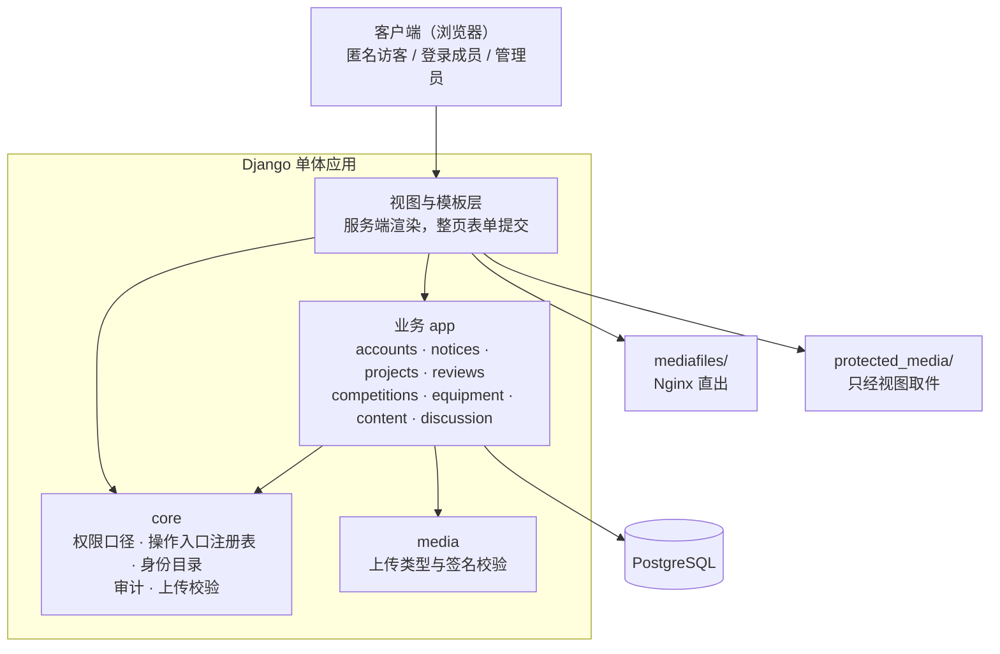

# 竞赛社团管理平台 · 设计说明（原型）

> **本文档于 2026-10-12 冻结**，描述的是**当初的设计**，不是代码现状——现状见
> [`../更新维护/模块与关系.md`](../更新维护/模块与关系.md)。
>
> **依赖方向规则与选型理由这一节会被经常回头看**，`CLAUDE.md` 也指向这里。
> 冲突时以代码与 `../更新维护/` 为准。

---

## 1. 总体结构

> **箭头方向 = 依赖方向**（上层指向它依赖的下层）。`core` 是横向的：任何 app 都可以依赖它，
> 它**不在加载期**依赖业务 app。两个存储根不是两个数据库——它们是**两类可见性**的物理分离，
> 见 §5。

**依赖方向规则**

| 规则 | 违反会怎样 |
|---|---|
| 跨应用只经对方的 `permissions` / `services` / `selectors` 公开函数，不直接查对方的模型（模型外键除外） | 模块边界失效，改一处的行为会从别处冒出来 |
| 方向单向：`projects`、`accounts` 在函数体内局部 import `reviews.permissions` 问「他是不是评审人」，**反过来不存在** | 加载期成环，模块无法单独测试 |
| `core` 不在加载期依赖业务 app（`core/stats.py` 的函数体内 import 是刻意的运行期依赖） | 注册表与身份目录就装不进 `AppConfig.ready()` |
| 每个 app 内部的分工固定（`models` / `permissions` / `services` / `selectors` / `views` / `panels`），视图与 admin 不越层 | 判定与事务散进视图，同一个问题出现第二个答案 |

> 全平台**唯一一条反向的加载期依赖**：`accounts/admin.py` 在模块级 `from reviews import lifecycle`
> （两张资格名册要取 `STAGE_*` 常量）。再添一条之前先确认不成环。

---

## 2. 技术选型与理由

➥ 这一节以后会被经常回头看。**否掉的方案与不选的理由**是重点——半年后只会记得结论。

| 选了什么 | 为什么 | 否掉了什么 | 不选的理由 |
|---|---|---|---|
| **Django + 服务端渲染** | 管理型 CRUD + 角色权限系统是 Django 的主场；内置 Admin、认证、权限、ORM、迁移、模板；单进程部署简单 | DRF + 前后端分离 | 曾把 DRF 作为「为后续 API 预留」空装着（零路由、零视图），后按「不留不用的依赖」移除。当前对外只有页面路由 |
| **少量原生 JS 做渐进增强** | 交互以整页表单提交为主 | HTMX | 页面脚本只做渐进增强（`static/js/` 下六个文件），引入 HTMX 换不来什么 |
| **Markdown 手写 + 服务端渲染 + `bleach` 白名单** | 正文在后台的 textarea 里手写，渲染结果过白名单 | 富文本编辑器组件（如 EasyMDE） | 见上；且模板里不写内联**可执行**脚本，编辑器组件会带来新的注入面 |
| **自定义 `User`（继承 `AbstractUser`）** | 绿场项目一步到位：`must_change_password`、三个资格字段、两个接单开关都随 User 走 | 用 `Profile` 扩展默认 User | 资格与强制改密是判定要读的字段，放在 OneToOne 上会让每次判定多一次 join |
| **数据库固定 PostgreSQL** | 用到部分唯一索引、`CHECK` 约束、`pg_trgm`、行级触发器 | SQLite | 这几样表达不出来；审计「只追加」与几组唯一性会随之失守。SQLite 已移除 |
| **本地 MEDIA 目录起步**（FileField 抽象） | 单机部署够用，抽象留着换存储的口子 | 直接上对象存储 | 社团规模不值当；将来量大时可经 `django-storages` 平滑切换 |
| **视频直传 MP4(H.264)/WebM，由 Nginx 直出**（含 Range） | 浏览器能直放，拖动进度不用经过 Python | ffmpeg 转码／多码率 | 要引入 ffmpeg 或对象存储，社团规模不值当 |
| **`django-axes`** | 登录失败计数与锁定（账号、IP 两个维度各算各的），不自造轮子 | — | — |

被外部要求、没得选的前提（必须 PostgreSQL、单台服务器、生产走 HTTPS）写在
[`SRS.md`](SRS.md) §5，不在这里。

---

## 3. 模块划分

| App | 职责 | **明确不做什么** |
|---|---|---|
| `config` | 项目配置包：settings、根路由、中间件（请求日志／强制改密）、日志 | 不放业务逻辑 |
| `accounts` | 用户、成员资料（学号／专业／联系方式／头像／简介／个人图册）、密码与资格的管理面 | 不做身份**判定**（全局资格归 `reviews.permissions`）；不建教师账号 |
| `notices` | 公告与「我的消息」：可见性判定、广播型与事件型两类消息 | 不渲染消息目标的页面；不判断评审规则 |
| `projects` | 项目组、联系人、成员、入组与建组申请、项目书本体的保存 | 不做评审；不建「联系人」用户组 |
| `reviews` | 项目书同行评审：轮次、两道关的任务、抽签、结论汇总与归档、改派、超级评审、接单开关 | 不存项目书本体（只读 `ProjectGroup.proposal`）；不写用户可见通知；不做身份授予 |
| `competitions` | 竞赛信息与项目组报名登记 | 不做报名审批；不与 `Competition` 建评审外键 |
| `equipment` | 设备台账与借用登记 | **不做审批**（登记即生效）、不预约／续借／逾期、不做部分归还；本模块**没有** `permissions.py` |
| `content` | 公开展示页：社团简介、历年获奖、成员风采、首页轮播 | 不做富文本编辑（Markdown 手写）；判重没有数据库约束 |
| `discussion` | 社团空间：板块、帖子、评论、成员目录 | 板块管理只认 Django `is_superuser`；不做事后审核 |
| `media` | 媒体库：图片／视频统一上传、校验 | 不做转码；不决定引用它的内容的可见性 |
| `core` | 平台底座：跨应用权限口径、操作入口注册表、身份目录、审计、上传校验、取件响应、指纹 | 不在加载期依赖业务 app；注册表与目录只管**登记**，判定与授予仍归各 app |

各模块的**现状**（边界、失败模式、不变量、已知限制）在 [`<app>/README.md`](../../accounts/README.md)，
那份才是模块的唯一出处；本表是当初的分法。

---

## 4. 关键数据结构与数据格式

➥ 只列当初定下来、后面会长期沿用的那几种。**具体字段与类型以代码为准**——这里写的是
「有哪些东西、各自干什么用」。

| 结构 | 用途 | 备注 |
|---|---|---|
| `accounts.User` | 身份与资格的唯一载体 | 三个资格字段相互独立；接单开关是 `User` 上的两个字段，**不是资格** |
| `ProjectGroup` | 项目组 | 联系人的唯一真相源是 `leader`（计算得出，不存用户组）；项目书只存这一份（`proposal`），评审侧不复制 |
| `ProjectSubmission` / `ReviewTask` / `ArchivedProposal` | 一轮送审；两张关的任务卡（`stage` 区分初审／评审）；通过轮的批注版归档 | 轮次状态只能经 `reviews/lifecycle.py` 的 `transition()` 写；「还在进行吗」只能问 `OPEN_STATUSES` |
| `Notice` / `NoticeRead` / `Message` | 广播型通知；已读回执；事件型消息（一行一个收件人） | `Message.kind` 加一个取值要同时改三处 |
| `AuditLog` | 写操作与安全事件的留痕 | `action` 字符串一旦发布就不再改；行级触发器拒 `UPDATE`／`DELETE` |
| 上传件与指纹 | 两类存储根（公开／受保护）；每个上传件落盘时算一份 SHA-256 | 受保护件落盘名换 uuid；项目书／批注版／归档版的下载响应另带 `Content-Digest` 与 `X-Checksum-SHA256` |

**数据格式的纪律**：接口、字段、参数默认值**以代码为准**，不另设文档。改了数据格式必须
升版本并在代码里**显式拒绝**旧数据，不得静默容错。

---

## 5. 关键设计取舍

| 取舍 | 选了 | 放弃了 | 为什么 |
|---|---|---|---|
| 联系人身份怎么存 | 由 `ProjectGroup.leader` **计算** | 冗余的「联系人」用户组 | 存两份必然分叉，而分叉了从页面上看不出来 |
| 审批链分几档 | 四档：报名／借用**登记即生效**；入组需该组联系人；建组需**任一**管理员；项目书需同行评审 | 一套统一的审批框架 | 每档的争议性不同——有争议的才值得引入状态机与待办 |
| 业务拒绝的形态 | 服务层抛领域异常，视图翻成 flash 后 **302** | REST 式的 4xx 错误码 | 服务端渲染 + 整页跳转；4xx 只留给权限与不存在 |
| 受保护件放哪 | **两个存储根**：公开配图在 `mediafiles/`，其余在 `protected_media/`（刻意不在前者之下） | 一个根 + 取件时在视图里判权限 | Nginx 直出目录没有规则，一条拼出来的路径就能绕过全部判定 |
| 测试怎么跑得快 | 只在 `manage.py test` 时把 `PASSWORD_HASHERS` 换成 MD5 | 默认 PBKDF2 跑全量 | 全库几百次建号原本要吃掉 4 分多钟。判定只认命令行里的 `test`，生产进程不经过它、口令仍是 PBKDF2 |
| 匿名怎么落地 | 页面、**落盘名**、下载头三处一起 | 只在页面上写「评审人 1」 | 任何一处漏掉，都能从存储层或下载头反向认出评审人 |

> 这一节只收**技术形态**的取舍。**平台规则的决策**（某件事全平台怎么保证、某个概念怎么表达——
> 如审计只追加怎么落、接单怎么表达、可见范围收到哪）记在
> [`../更新维护/ADR.md`](../更新维护/ADR.md)，那里也写了「没选什么、代价是什么」。

---

## 6. 外部依赖

> **这是原型期的清单。**现状以 `requirements*.txt` 的锁文件为准；许可与分发义务的评估见
> [`../更新维护/许可.md`](../更新维护/许可.md)——加了依赖别回来改这里（本目录已冻结）。

| 依赖 | 用途 | 备注 |
|---|---|---|
| Django 5.2 | Web 框架、ORM、认证、Session、Admin、迁移、模板、测试 | |
| PostgreSQL ≥14 | 数据库 | 部分唯一索引、`CHECK`、`pg_trgm`、行级触发器 |
| `django-axes` | 登录失败计数与锁定 | 账号与 IP 各算各的 |
| `bleach` | 富文本 HTML 白名单过滤 | |
| Markdown | 正文渲染 | |
| Pillow | 校验上传图片的真实格式，并挡解压炸弹 | 主版本升级要确认 `DecompressionBombError` 与 `MAX_IMAGE_PIXELS` 行为未变 |
| psycopg | PostgreSQL 驱动 | **LGPL**，分发义务见 [`../更新维护/许可.md`](../更新维护/许可.md) |
| gunicorn | 生产 WSGI 服务 | 仅 `requirements-prod` |
| Nginx | 反代、静态与 `/media/` 直出、视频 Range | 受保护件的边界依赖它**不**指到 `protected_media/` |
| systemd | 服务与备份定时器 | |

> 与外部系统之间的**接口细节不写在这里**——接口以代码为准。

---

## 7. 参考

- 阶段骨架：[`里程碑.md`](里程碑.md)
- 需求与约束：[`SRS.md`](SRS.md)
- 现状：各 `<app>/README.md`、[`../更新维护/`](../更新维护/)
