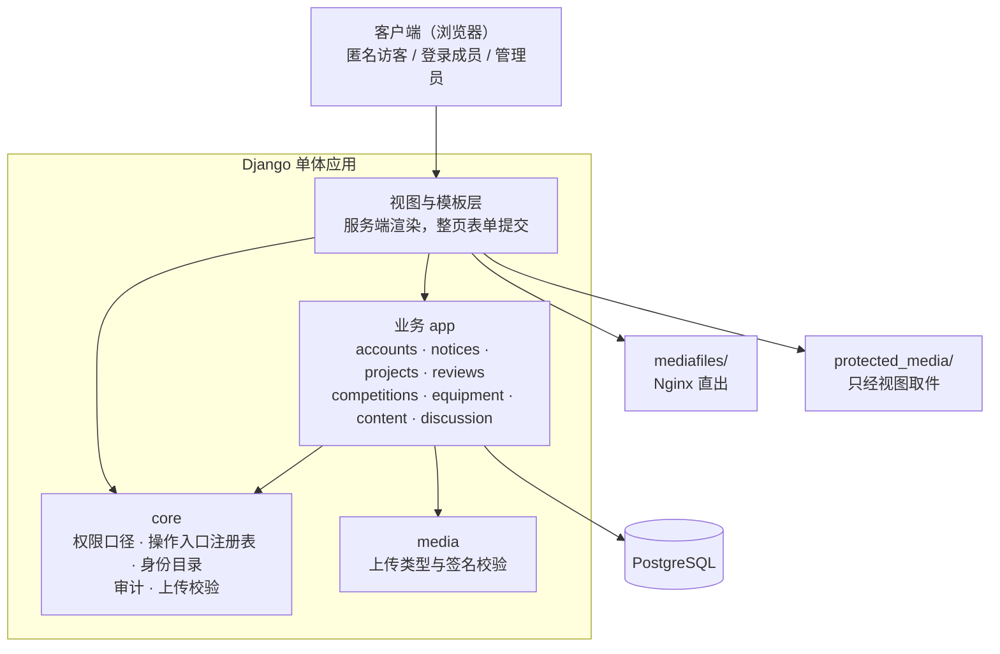

# 竞赛社团管理平台 · 设计说明（原型）

> **本文档于 2026-10-12 冻结**，描述的是**当初的设计**，不是代码现状——现状见
> [`../更新维护/模块与关系.md`](../更新维护/模块与关系.md)。
>
> 它只回答一个问题：**当初为什么这么选、否掉了什么**。模块划分、依赖方向、数据结构、
> 外部依赖清单都**不在这里**——那些是现状，读代码与 [`../更新维护/模块与关系.md`](../更新维护/模块与关系.md)。
> 冲突时以代码与 `../更新维护/` 为准。

---

## 1. 总体结构

> **箭头方向 = 依赖方向**（上层指向它依赖的下层）。`core` 是横向的：任何 app 都可以依赖它，
> 它**不在加载期**依赖业务 app。两个存储根不是两个数据库——它们是**两类可见性**的物理分离，
> 见 §5。

---

## 2. 技术选型与理由

➥ 这一节以后会被经常回头看。**否掉的方案与不选的理由**是重点——半年后只会记得结论。

| 选了什么 | 为什么 | 否掉了什么 | 不选的理由 |
|---|---|---|---|
| **Django + 服务端渲染** | 管理型 CRUD + 角色权限系统是 Django 的主场；内置 Admin、认证、权限、ORM、迁移、模板；单进程部署简单 | DRF + 前后端分离 | 曾把 DRF 作为「为后续 API 预留」空装着（零路由、零视图），后按「不留不用的依赖」移除。当前对外只有页面路由 |
| **少量原生 JS 做渐进增强** | 交互以整页表单提交为主 | HTMX | 页面脚本只做渐进增强（`static/js/` 下六个文件），引入 HTMX 换不来什么 |
| **Markdown 手写 + 服务端渲染 + `bleach` 白名单** | 正文在后台的 textarea 里手写，渲染结果过白名单 | 富文本编辑器组件（如 EasyMDE） | 见上；且模板里不写内联**可执行**脚本，编辑器组件会带来新的注入面 |
| **自定义 `User`（继承 `AbstractUser`）** | 绿场项目一步到位：`must_change_password`、三个资格字段、两个接单开关都随 User 走 | 用 `Profile` 扩展默认 User | 资格与强制改密是判定要读的字段，放在 OneToOne 上会让每次判定多一次 join |
| **数据库固定 PostgreSQL** | 用到部分唯一索引、`CHECK` 约束、`pg_trgm`、行级触发器 | SQLite | 这几样表达不出来；审计「只追加」与几组唯一性会随之失守。SQLite 已移除 |
| **本地 MEDIA 目录起步**（FileField 抽象） | 单机部署够用，抽象留着换存储的口子 | 直接上对象存储 | 社团规模不值当；将来量大时可经 `django-storages` 平滑切换 |
| **视频直传 MP4(H.264)/WebM，由 Nginx 直出**（含 Range） | 浏览器能直放，拖动进度不用经过 Python | ffmpeg 转码／多码率 | 要引入 ffmpeg 或对象存储，社团规模不值当 |
| **`django-axes`** | 登录失败计数与锁定（账号、IP 两个维度各算各的），不自造轮子 | — | — |

被外部要求、没得选的前提（必须 PostgreSQL、单台服务器、生产走 HTTPS）写在
[`SRS.md`](SRS.md) §5，不在这里。

---

## 3. 关键设计取舍

| 取舍 | 选了 | 放弃了 | 为什么 |
|---|---|---|---|
| 联系人身份怎么存 | 由 `ProjectGroup.leader` **计算** | 冗余的「联系人」用户组 | 存两份必然分叉，而分叉了从页面上看不出来 |
| 审批链分几档 | 四档：报名／借用**登记即生效**；入组需该组联系人；建组需**任一**管理员；项目书需同行评审 | 一套统一的审批框架 | 每档的争议性不同——有争议的才值得引入状态机与待办 |
| 业务拒绝的形态 | 服务层抛领域异常，视图翻成 flash 后 **302** | REST 式的 4xx 错误码 | 服务端渲染 + 整页跳转；4xx 只留给权限与不存在 |
| 受保护件放哪 | **两个存储根**：公开配图在 `mediafiles/`，其余在 `protected_media/`（刻意不在前者之下） | 一个根 + 取件时在视图里判权限 | Nginx 直出目录没有规则，一条拼出来的路径就能绕过全部判定 |
| 测试怎么跑得快 | 只在 `manage.py test` 时把 `PASSWORD_HASHERS` 换成 MD5 | 默认 PBKDF2 跑全量 | 全库几百次建号原本要吃掉 4 分多钟。判定只认命令行里的 `test`，生产进程不经过它、口令仍是 PBKDF2 |
| 匿名怎么落地 | 页面、**落盘名**、下载头三处一起 | 只在页面上写「评审人 1」 | 任何一处漏掉，都能从存储层或下载头反向认出评审人 |

> 这一节只收**技术形态**的取舍。**平台规则的决策**（某件事全平台怎么保证、某个概念怎么表达——
> 如审计只追加怎么落、接单怎么表达、可见范围收到哪）记在
> [`../更新维护/ADR.md`](../更新维护/ADR.md)，那里也写了「没选什么、代价是什么」。

---
