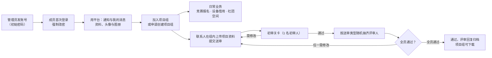

# 业务流

> 这份文件**同时是用户手册**——它们讲的是同一件事：这东西怎么用。合成一份，是因为分开写
> 必然出现两处描述同一个流程，然后开始互相漂移。
>
> **读者**：用这个平台的人（成员、项目组联系人、评审人／初审人／超级评审、管理员）。
> **不写**：按钮级细节（界面自己会说）、技术性限制（见代码与 [`模块与关系.md`](模块与关系.md)）。

**什么时候看**：第一次用；忘了某个操作怎么做；收到一条看不懂的提示；写用户可见文案之前。

---

## 1. 主流程

➥ **价值链级别**——从「有人能登录」到「项目资料审完归档」经过哪几大步。

| # | 干什么 | 产出什么 |
|---|---|---|
| 1 | 管理员发账号（初始密码当面告知） | 一个能登录、首次登录必须改密的成员 |
| 2 | 成员改密后用平台 | 资料、消息、所属项目组 |
| 3 | 入组（联系人审核）或建组（任一管理员同意） | 项目组与成员关系、联系人身份 |
| 4 | 日常业务：报名竞赛、借还设备、在社团空间发帖 | 报名记录、借用记录、帖子与评论 |
| 5 | 联系人在组内上传项目资料并提交送审 | 一个未结束的评审轮次 |
| 6 | 初审人给结论 | 通过（转评审并抽齐评审人）或需修改（本轮结束） |
| 7 | 评审人给结论 | 全员通过则通过，否则退回项目组重来 |
| 8 | 通过的轮次归档 | 评审回复，项目组详情页可下载 |

> **卡住了怎么办**：管理员可在后台把「待处理且该轮尚未判结论」的任务**改派**给别人；
> 超级评审可以对进行中的轮次（含初审中）**一票敲定**。

---

## 2. 常见任务

### 2.1 第一次用（成员）

1. 管理员会给你**账号和初始密码**——平台**不开放注册**，也没有「忘记密码」自助入口。
2. 打开站点 → 「登录」→ 输入账号与初始密码。
3. **第一次登录必须改密码**。改完之前，除了改密页和登出，其他页面一律跳回改密页——这是有意的，初始密码是别人替你设的。
4. 改完进入**成员中心**：顶栏是各功能入口，中间的卡片按你的身份显示——**每个人看到的入口不一样**（普通成员、项目组联系人、评审人、初审人、超级评审、管理员各有各的）。
5. 建议先补**个人资料**（姓名、学院、专业、联系方式）。姓名会出现在成员目录、获奖页与「我的获奖」搜索里；不填姓名时页面上会退回显示账号名。

### 2.2 第一次用（管理员）

1. 用超级管理员账号登录前台，再打开 `/admin/`（后台界面固定中文，不走 `/en/`）。
2. 建成员账号：后台「账号」→ 新增。**初始密码建议设成学号／工号**并当面告知本人；新账号第一次登录会被强制改密。
3. 需要谁做评审，就在建号时勾上资格（也可以之后在用户列表页勾选多人批量授予）。
4. 后台首页顶部有「**身份管理**」分组，六张只读名册回答「这个身份上都有谁」——它们只列持有人，**不提供分配入口**。

### 2.3 看通知与「我的消息」

- **公开公告**在 `/notices/`，不用登录也能看。
- **内部通知**与**仅联系人可见的通知**在成员中心的「**我的消息**」里。每条带类型、标题、来自、说明与时间。
- 未读的整行标亮；**点开即已读**；页头有「全部已读」一次清完。
- 有未读消息时，**每一页**顶栏的「成员中心」都换成琥珀色底、标签右边跟上一枚条数徽标；点开看过就少一条，全看完就变回普通链接。
- 「我的消息」里还会出现：别人 **@ 你**的帖子或评论、**评论了你的帖子**、**有人给你发的私信**、**分给你的评审／初审任务**、**评审结果**、**入组申请与结果**、**建组申请与结果**。任务交掉或改派走后，对应消息会自动消失。
- **「说明」列**放的是这一行的关键信息：通知写发给谁，评论与私信写内容摘要，任务与结果写办到哪一步了。**入组／建组申请**那两条跟着申请走——申请被处理后就地变成「已由 某某 审核通过」或「已被 某某 拒绝」，点开前就知道办没办、是谁办的。
- 收不到内部通知？多半是**你不在该通知绑定的用户组里**——想知道自己在哪些组，看个人信息页「当前身份」最末那条「用户组」。

**私信**（成员之间一对一，一次最多 1500 字）：

- **发**：社团空间里点开某位成员的信息主页 → 页头「私信」→ 在弹出的窗口里写 → 发送。
- **回**：「我的消息」里那条私信的行上直接点**「快速回信」**，收件人已经填好；点开那条消息进详情页，上面也有「回复」。回复就是再发一条普通私信，没有「会话」这回事。
- **读**：点开看全文。**读过不会消失**——那是记录，不是提醒；不想要了就进详情页按「删除私信」。
- **删掉就没了**：没有「回收站」，也没有审计底账——删之前请确认。管理员在后台能看到**尚未删除**的私信（只读，改不了也删不掉），你删掉之后后台也查不到。
- 对方能看到的是**你的姓名**（没填姓名时是账号名）与正文；其余资料按成员资料页的公开口径。

### 2.4 加入项目组 / 申请创建项目组

- **加入**：成员中心 →「项目组」→ 找到组 → 申请加入（可写理由）→ 等该组**联系人**审核。被拒了可以再申请。
- **创建**：同一页面上的「申请创建项目组」，填名称与描述（学院与指导老师可以后补）。申请汇总在**管理员的「评审」页**，**任何一位管理员同意即建组**，申请人就是新组的联系人。
- 项目组页**对任何登录成员都列出全部项目组**（谁都能看、都能申请加入，管理员也一样）；只想看自己参与的组时，用页面上的「我的项目组」筛选。联系人另外能在自己的组上看到管理入口。

### 2.5 评审人 / 初审人：把手上的任务交掉

- 收到任务时「我的消息」会有一条提醒，成员中心的「评审」入口也能进。
- **初审**（每轮的第一道关）：下载项目资料 → 给「通过（转评审）」或「需修改（打回）」+ 意见。通过后系统才随机分配评审人；打回则这一轮直接结束，项目组改完可以重新送审。
- **评审**：下载项目资料 → 填意见与结论（通过／需修改），**可以另附一份评审回复压缩包**（选填）。
- **全员通过才算通过**；任何一人选「需修改」就退回项目组。通过的轮次会把收到的评审回复归档，项目组详情页可下载。
- **你的身份对项目组匿名**：页面上只显示「初审」「评审人 1/2/3」「超级评审」，评审回复的文件名也不含你的名字。**请别在意见正文或文件属性里写下能认出你的信息**。**唯一例外是「线下答辩」的讨论区**——那是实名协调渠道，评论会显示姓名（见 2.18）。
- **要暂停接单**（一段时间不收新任务）：成员中心的「接单状态」里，把初审或评审那个开关关掉（两件各管各的）。关掉后不会再被抽到新任务，**已经派给你的任务不受影响**；想接时打开即可，没有时间限制。**手上有未完成的任务时关不掉**——先交掉，或请管理员改派走。

### 2.6 报名竞赛

- 「竞赛信息」页列出所有竞赛。**登记报名只有项目组联系人能做**（限自己的组），管理员可以替任意组登记。
- 每场竞赛的**已报名项目组对全体登录成员可见**，项目组详情页也列出**本组**报名的竞赛（谁报了哪场不算秘密：项目组列表本来就列着全部组与成员）。**能改的只有自己能管的组那一行**——看到别人的报名不等于能替他改。
- 报名时选参赛成员并指定**竞赛组长**（必须从参赛成员里选）。
- 截止前可以修改或放弃；**截止之后前台什么也改不了**（包括删掉自己的记录）——平台上的名单要和报给主办方的对得上。确有需要，找管理员在后台补录。

### 2.7 借用与归还设备

- **借用的入口只对项目组成员开放**（没有加入任何项目组的成员看不到这个入口）。
- 借用是**登记即生效**，没有审批；填一个计划归还日期即可，库存不够会被拒。
- 「借用记录」里能看自己的记录并登记归还（借用入口叫「设备借用」）。**被移出项目组之后仍然可以归还**手里的设备。
- 归还重复点不会把库存加两遍。

### 2.8 社团空间：发帖、评论、@ 某人

- 「社团空间」按板块组织，登录成员都能看与发。板块条可以横向滑动；过长的帖子会先折到一屏，点「展开全文」看全。
- 发帖可以带图（每帖最多 3 张，单张 3 MB）。
- **@ 姓名** 会给对方发一条「我的消息」（输入 `@` 会弹人名补全；不补全、手打 `@姓名` 一样有效）。自己 @ 自己不会发。
- **别人评论你的帖子**，你也会收到一条「我的消息」（类型「评论」，说明列是那条评论的摘要，点开落到那条评论上）；自己评论自己的帖子不发。评论里已经 @ 到你时只发「提及」那一条，不会重复。
- 帖子和评论：作者能改删自己的，**管理员能删任意帖子／评论并置顶**；评论是**软删除**（页面上消失，但记录还在）。**只有超级管理员**能创建或删除板块，且只能删空板块。

### 2.9 个人资料、头像与图册

- 个人信息页左栏是资料表单，右栏是头像与只读的「当前身份」，下方是个人图册。
- 头像 ≤2 MB；图册可**一次选多张**批量上传（放不下的、不合格的会逐张点名，其余照常入册），单张 ≤5 MB、**每人合计 ≤100 MB**。图册支持逐张排序、改排布（普通／大图／整行）与删除。
- 姓名、学号、学院、专业、特长、简介、手机号与其他联系方式都由你自己维护；**学号与邮箱不会展示给其他成员**，其余公开项在成员只读资料页对登录成员可见。
- 改不了账号名与邮箱？那是设计如此，需要改找管理员。

### 2.10 社团成果：获奖、论文与专利

- 顶栏「社团成果」是**聚合入口**：进入后看到「历年获奖」「学术论文」「发明专利」三块，点其中一块才是对应的清单。
- 三类成果都允许登录成员在前台**添加记录**（公开栏目里唯一允许成员新增内容的一组）；管理员也可在后台增删改。
- 「历年获奖」保持原口径：同一年份 + 同一赛事 + 同一批获奖人 + 同一层级只留一条；附件分「获奖证书」与「参赛图片」，**证书**能勾选打包下载（一次最多 100 条）。
- 「学术论文」登记题目、作者、期刊／会议、年份、类型、收录情况、DOI／原文链接与摘要；同一年题目与作者都相同的论文会被拦下。
- 「发明专利」登记名称、发明人、专利号／申请号、年份、类型、当前状态与简介；专利号大小写不敏感唯一，重复的会被拦下。
- 三张清单各自有一个搜索框同时匹配该类的文本字段与年份；论文与专利不收附件，论文只提供 DOI／原文链接。

### 2.11 管理员：发账号与重置密码

- 后台「账号」→ 新增：设初始密码、可当场勾评审资格。**没有注册入口，也没有自助找回**——成员忘密码就由你在后台重置密码（重置后会重新进入「首次改密」流程）。
- 登录失败 10 次（账号与 IP 各算各的）会锁定 30 分钟，可在 `/admin/axes/accessattempt/` 查看并删掉记录提前解锁。

### 2.12 管理员：授予／撤销评审资格

- **单个**：账号详情页的「权限」区勾选（评审／初审／超级评审，三者相互独立）。
- **批量**：用户列表页勾选多人 → 用那六个动作（授予／撤销 × 三种资格）。
- 重复授予已持有的资格不会产生多余的审计记录。**没有「批量授予管理员」这个动作**——把一批人放进后台应当逐个确认。

### 2.13 管理员：发布通知、竞赛与展示内容

- **通知**：后台「通知」：正文支持 Markdown + 图片／视频，可置顶。**可见范围**三选一：`公开`（访客可见）、`内部`（要选至少一个用户组）、`仅项目组联系人`。用户组（`auth.Group`）只用于内部通知的投递范围，**它不是身份**；组页的「组内用户」是一个穿梭框，一次挑一批人。
- **竞赛**：填名称、说明、截止时间、组队要求（前台入口叫「竞赛信息」）；发布后联系人就能报名。
- **设备**：维护台账（总量与可借数量）——前台入口叫「设备借用」，借用记录在「借用记录」里。
- **展示内容**：社团简介、社团成果（历年获奖、学术论文、发明专利）、成员风采、首页轮播；获奖与风采的图片／视频统一进「媒体库」，公开页引用同一份文件。

### 2.14 管理员：处理「创建项目组申请」

- 入口在**管理员登录后的「评审」页**（管理员不需要评审资格）。
- 任一管理员同意即通过并立刻建组；这条申请随即从**其他管理员的队列里消失**（不会建出第二个组）。
- 那条「待审核」消息**不跟着撤回**，但它自己**就地改成结论**：别人同意／拒绝之后，说明那一格变成「已由 某某 审核通过」或「已被 某某 拒绝」，一眼看得出是谁办的、办成了没有。点进去看到的仍是评审页（那条申请已经不在队列里了），这不是故障——只有拿着过期的页面重复提交，才会看到「该申请已被处理」。

### 2.15 管理员：评审中途出问题

- **有人失联／有利益冲突**：后台「项目评审 → 评审任务」详情页可以把**待处理且该轮尚未判结论**的任务**改派**给别人。这是唯一的补救路径；已经给出结论的任务不能换人。
- **整轮卡住或存在争议**：超级评审可以在「评审」页对进行中的轮次（**含初审中**）直接通过或打回，一票敲定，等待中的任务随即释放。
- **确需作废**：后台可以**删整轮**（连同它的初审与评审任务，已归档的轮次删不掉）。
- 单独删一条评审任务是被禁止的——那会悄悄改变该轮所需的评审人数。

### 2.16 管理员：「身份管理」六张名册

管理员、评审人、初审人、超级评审、项目组联系人、项目组成员。**都是只读的**：全局身份在用户列表页批量改；**项目组联系人／成员这两张名册改不了**——要改归属，去项目组页走业务动作（入组审批、联系人转让）。

### 2.17 项目组联系人 / 管理员：申请线下模拟答辩

- 入口在**项目组管理页**的「线下模拟答辩」面板里，点「申请线下模拟答辩」。申请绑定这个项目组，文本框不超过 500 字，**请写明答辩的时间和地点**——这是排期的依据。
- 提交后，当前持有评审人、初审人或超级评审资格的成员都会在「我的消息」收到一条带链接的消息；评审页的「线下答辩」里也能看到。管理员没有评审资格时不会收到消息，但仍能进排期表。
- 申请先进入「安排中」。评审人、管理员和申请人本人都可以在详情里评论：时间要改、地点要换、自己能不能到场，都写在这里。
- 申请人可以随时改正文；**每次实际改动都会自动在讨论里留一条「申请者修改了答辩申请」**，内容没变则不会留记录。
- 申请人或管理员可以「关闭申请」。关闭后进入「已确定」，正文与讨论都转为只读；需要新的安排时，另发一条申请。
- **重复点「提交申请」不会造出两条一样的申请**：同组、同申请人、同正文在 10 秒内视为同一次提交，直接打开刚建的那条。关闭后从旧页面再点修改／评论／关闭，会回到详情并提示，不是错误页。
- **项目组联系人换了以后，新联系人能在组管理页看到本组申请，但不能替前任修改或关闭**——修改只归申请人，关闭只归申请人或管理员；评论仍按评审资格／管理员／申请人这一组身份。
- 同一个项目组可以同时有多条「安排中」的申请，按创建时间倒序列出。

### 2.18 评审人：查看线下答辩排期并参与讨论

- 入口在**评审页**右上角的「线下答辩」。页面分「安排中」与「已确定」两块，都按创建时间倒序。
- 点进「安排中」的申请可以发表评论；点进「已确定」的只能看最终正文和完整讨论历史，不能再改也不能再评论。
- **线下答辩的评论是实名的**：评审人在这里显示真实姓名，方便联系人确认谁到场、谁不能来。这是平台匿名口径的唯一例外；评审意见、结论与评审回复仍按匿名规则处理。
- 没有评审资格、也不是申请人本人的成员看不到这个页面（直接访问会得到 403）。申请人本人即使没有评审资格，也能通过直接链接回到自己那条申请。

---

## 3. 出错了怎么办

➥ **用户侧**的常见情况。部署与运行时的故障在 [`开发与部署.md`](开发与部署.md) §6。

| 你看到的 | 什么意思 | 怎么办 |
|---|---|---|
| 一直被送回改密页 | 首次登录还没改密码 | 完成改密；改完才能用其他功能 |
| 「没有可用的初审人…（另有 M 人已关闭接收新任务）」 | 有资格的人要么关掉了开关、要么没资格 | 稍后再试，或让管理员补资格／请关掉的人打开 |
| 「可用的评审人不足 N 人…」 | 同上，这只送审开不出来 | 同上（这条预检就是为了不让你开出一轮推不动的送审） |
| 「当前可用的评审人不足 N 人（另有 M 人已关闭接收新任务）」 | 抽人时名额凑不齐 | 等关掉的人打开开关，或找管理员 |
| 「该申请已被处理」 | 另一位管理员已经处理过同一条（多见于拿着过期页面重复提交） | 不是故障，刷新页面即可。正常情形下那条申请早已从你的队列里消失，你手里那条**消息**的说明也已就地写成「已由 某某 审核通过」或「已被 某某 拒绝」——点进去看不到东西也是同一个原因 |
| 「禁止访问（403）」 | 你不是这个操作允许的身份 | 找管理员确认身份／资格 |
| 「页面不存在（404）」 | 要么真的没有，要么**你没有权限看**（有些地方故意不告诉你它存不存在） | 需要就问管理员 |
| 上传被拒 | 类型、大小、文件签名有一项不符 | 看提示里的上限；图片 10 MB、视频 500 MB、项目资料与评审回复 500 MB、头像 2 MB、图册单张 5 MB |
| 表单提交报 CSRF／反复失败 | 换了入口或代理配置有问题 | 刷新重登；仍不行找维护者 |

---

## 4. 这个平台不做什么（有意如此）

- 不开放注册；没有自助找回密码 —— 都由管理员经手。
- 竞赛报名与设备借用**没有审批流**：登记即生效。
- 评审**不能撤回**：结论一旦落下就是记录；要补救只能由管理员改派（未判结论的）或超级评审一票敲定。
- 视频不做转码：请上传 MP4（H.264）或 WebM。
- 后台界面只有中文（前台是中英双语，英文加 `/en/` 前缀，地址决定语言）。
- 站内没有即时聊天：有「我的消息」里的一对一**私信**（要自己去点开才看得到），但没有在线状态、没有实时推送、不做群聊，也不会有声音或桌面提醒——新消息只体现在顶栏「成员中心」的未读徽标与成员中心的未读提醒上。

> 这些「不做」的**设计理由**在 [`../原型设计/SRS.md`](../原型设计/SRS.md) §2——这段是写给使用者的说法，
> 不含实现细节，与那一节不冲突。
