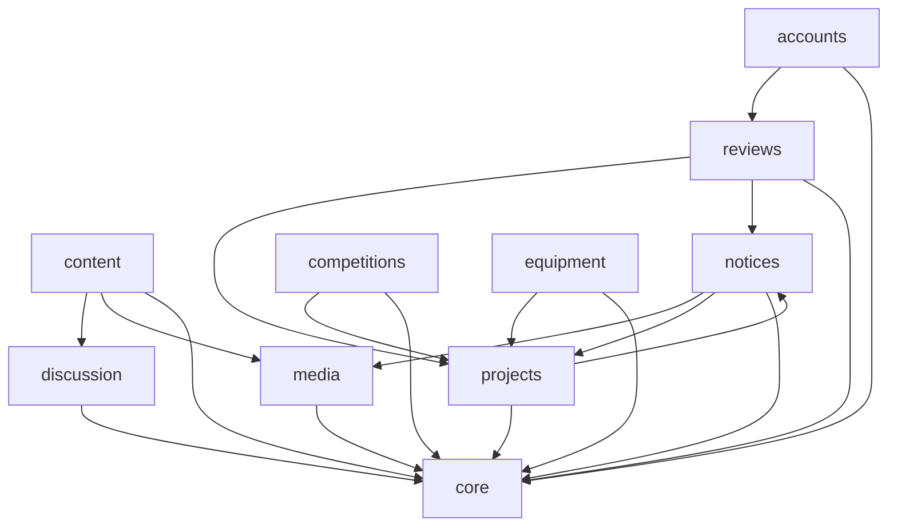

# 模块与关系

> **这份文件写的是结构**：有哪些模块、谁依赖谁、跨模块的约定是什么。
> **模块内部的事不在这里**——职责与边界、失败模式、不变量、数据流、测试要点与已知限制，
> 都在代码旁边的 [`<app>/README.md`](#4-各模块的详细说明在哪) 里。写不下去就说明写得太低了。

**什么时候看**：改代码前定位模块；加一个模块或一条入口；不确定某件事该问谁。

---

## 1. 模块清单

| 模块 | **明确不做什么** |
|---|---|
| config | 不放业务逻辑 |
| accounts | 不产出「谁能做什么」的判定（本 app **没有** `permissions.py`）；不建教师账号 |
| notices | 不渲染别的 app 的消息目标页（帖子／项目组／评审队列；私信的详情页是它自己的）；不判断评审规则 |
| projects | 不做评审；不建「联系人」用户组 |
| reviews | 不存项目书本体；不写用户可见通知；不做资格授予 |
| competitions | 不做报名审批；送审类型不与竞赛建外键 |
| equipment | 不做审批／预约／续借／逾期，不做部分归还 |
| content | 不做富文本编辑；判重没有数据库约束；不登记操作入口 |
| discussion | 板块管理只认 Django `is_superuser`；不做事后审核 |
| media | 不做转码；不决定引用它的内容的可见性 |
| core | 不在加载期依赖业务 app；注册表与目录只管**登记** |

**边界比职责更重要**——写不清「不做什么」，模块就会不断膨胀。

---

## 2. 模块间关系

实线是**模块级**（加载期）的依赖。三条要注意的：

- **`core` 是横向的**：任何 app 都可以依赖它；它**不在加载期**依赖业务 app（`core/stats.py` 在函数体内 import 业务模型与判定，那是刻意的运行期依赖）。`media` 同理只被依赖。
- **`notices ↔ projects` 是互相依赖的**，别以为方向是单向的：`notices/visibility.py` 要问 `projects.permissions.is_project_contact`（「仅联系人可见」的通知），而 `projects/services.py` 要调 `notices.services`（入组与建组的消息）。两处都在**不同子模块**里，所以不成环——但**动这两条中的任一条之前，先确认没有把环闭合**。
- **`accounts → reviews` 是全平台唯一一条反向的加载期依赖**（`accounts/admin.py` 模块级 `from reviews import lifecycle`，两张资格名册要取 `STAGE_*` 常量）。业务上 `reviews` 依赖 `accounts` 的资格字段，代码上却反过来 import——再添一条之前先确认不成环。

打断加载期依赖的局部 import **一律写在函数体内，且每一处都带理由注释**（`grep -rn '^    from ' */`
即可列全）——**别为了「看着整齐」把它们提到模块级**，那会把上面这张图里的依赖变成环。

> **自测**：一次纯重构（行为不变）不该逼你改这张图。改了，说明画得太细。

---

## 3. 跨模块约定

➥ 代码里读不出「这是故意的」那类约定。**只列全平台级的**——某一处对外承诺了什么、
某个模块的细节口径，都在那个模块自己的 README 里（见 §4）。

| 约定 | 内容 |
|---|---|
| **服务层什么时候才建** | `services.py` 只为「**被多处复用**」或「含**多表事务／约束翻译**」的写操作而建；只有一个调用点的「保存 + 一条审计」留在视图里更清楚——不为统一而绕一层 |
| **用户可见文案归模板与 `panels`** | 服务层抛领域异常（`ReviewError` 这类），**由视图翻译成 `messages`**；服务层不写用户可见文案 |
| **判定只写一处** | 「谁能做什么」写在各自的 `permissions.py`（或 `notices/visibility.py` 这类单点模块）。视图门槛一律 `core.permissions.require`；「谁算管理员」只问 `core.permissions.is_admin`，不写 `user.is_staff` |
| **跨应用只走公开面** | 只经对方的 `permissions` / `services` / `selectors` 公开函数，不直接查对方的模型（模型外键除外）。要打断加载期依赖时用**函数体内**局部 import 并写明理由（理由写在那一行的注释里） |
| **用户组不是身份** | Django `auth.Group` 只是**内部通知的投递范围**（`Notice.visible_groups`），既不是项目组也不是身份名册，不进 `core.roles` 目录。三种「组」的辨析见 [`../../accounts/README.md`](../../accounts/README.md) |
| **审计 action 字符串不再改** | `core.audit.record_audit` 的 action 一旦发布就保持连续；新增写操作照着相邻那个取名。「只追加」由**数据库触发器**守，不是靠约定——副作用与逃生口见 [`开发与部署.md`](开发与部署.md) §6 |
| **每个自家包都要在 `LOGGING["loggers"]` 里显式列一节** | 新增包忘了配（或只配一半），日志会静默不落盘。`config/tests.py` 的 `AppLoggerTests` 从四个方向盯着：实际的包与测试里的清单相等、配置节在、运行时挂着文件 handler、每个包真发一条 `INFO` 能落盘 |
| **登记归 `AppConfig.ready()`** | 操作入口（`core/registry.py`）与身份（`core/roles.py`）在各 app 的 `ready()` 里登记；后台「身份管理」分组的顺序必须与 `core.roles` 的 `sort_order` 一致。**目录只登记**——判定仍归各 app 的 `permissions`，授予仍归 `services` |
| **约束名是承诺** | 几组唯一约束与 `CHECK` 的名字被迁移与测试引用（名单读 `models.py` 的 `Meta.constraints` 即得）；**改名要连迁移一起动，改行为（放宽/收紧）更要先想清存量数据怎么办** |
| **数据格式以代码为准** | 接口、字段、参数默认值不另设文档。改了数据格式必须升版本 + 在代码里**显式拒绝**旧数据，不得静默容错 |
| **双层权限控制** | 模板层按权限隐藏入口，**只影响展示**；真正的权限边界是视图层的二次校验。只隐藏不设防是常见漏洞——新加一个入口时，模板与视图两边都要判 |
| **受保护件落在另一个存储根** | `PRIVATE_MEDIA_ROOT` **刻意不在** `MEDIA_ROOT` 之下，受保护件因此没有任何 HTTP 路径能直接命中。这条边界是「取件必须走视图」的真正保障——不是 `url()` 抛异常（它返回空串，理由见 [`../../core/README.md`](../../core/README.md)） |

**下面这些各有唯一的主，别在这里重复**（v2 的规矩：引用，不复述）：

| 想知道 | 去哪 |
|---|---|
| 拒绝的四种形态（403／404／405／302）、业务拒绝为什么不是 4xx、几处「刻意为之的错位」 | [`接口.md`](接口.md) |
| 身份有哪几种、怎么管理（`GLOBAL` / `OBJECT` 两种作用域） | [`权限.md`](权限.md) |
| 指纹的三条承诺、来源 IP 的单一口径、`core.storage` 的边界 | [`../../core/README.md`](../../core/README.md) |
| 消息表的所有权、加一个 `kind` 要改哪三处 | [`../../notices/README.md`](../../notices/README.md) |
| `can_view_group` 的并集语义、联系人为什么由 `leader` 算 | [`../../projects/README.md`](../../projects/README.md) |
| 时间端点的宽严（别记「一律」）、文件大小一律写 MB | [`../术语表.md`](../术语表.md) |
| 模块内部的文件分工（哪个面归 `models`／`services`／`views`…） | 各 app README §1 的「面 → 落点」表 |
| 注释规范 | [`开发与部署.md`](开发与部署.md) §3 |
| i18n 的规则与两个坑 | [`../../CLAUDE.md`](../../CLAUDE.md) §4、[`../术语表.md`](../术语表.md) 的「惰性译文」 |
| 样式与模板约定 | [`../../static/css/app.css`](../../static/css/app.css) 的头部注释 |

---

## 4. 各模块的详细说明在哪

**模块说明就地放在代码旁边**（`<app>/README.md`），六节：职责与边界（含**明确不做什么**）／
关键接口与失败模式／状态与不变量／数据流与时序／错误处理与诊断／测试要点与**已知限制**。
它跟代码在同一个提交里更新，改哪块就先看哪块那一篇。

| 模块 | 说明 | 模块 | 说明 |
|---|---|---|
| config | [`config/README.md`](../../config/README.md) | equipment | [`equipment/README.md`](../../equipment/README.md) |
| accounts | [`accounts/README.md`](../../accounts/README.md) | content | [`content/README.md`](../../content/README.md) |
| notices | [`notices/README.md`](../../notices/README.md) | discussion | [`discussion/README.md`](../../discussion/README.md) |
| projects | [`projects/README.md`](../../projects/README.md) | media | [`media/README.md`](../../media/README.md) |
| reviews | [`reviews/README.md`](../../reviews/README.md) | core | [`core/README.md`](../../core/README.md) |
| competitions | [`competitions/README.md`](../../competitions/README.md) | | |

> **为什么不成一份**：这 11 篇里有大量**读代码读不出来**的东西——失败模式、并发与锁、
> 约束为什么落在数据库、已知限制。把它们收成一份文件只有两条路：丢信息，或者把这份文件
> 撑成新的巨石。就地的好处是**改哪个模块只动哪一篇**，而且它与代码在同一个提交里。

---

## 5. 可选扩展

➥ 已落地的能力（账号与强制改密、通知可见性、站内消息、公开展示与媒体库、项目组、
竞赛报名、设备借用、项目书同行评审含初审关卡、操作入口注册表、审计日志、生产部署工件）
不再列在这里。

- **视频转码与容量**：当前直传 MP4 不转码；视频量大时引入 ffmpeg 转码／多码率，或切对象存储。
- **媒体大小上限**：图片 ≤10 MB、视频 ≤500 MB 是默认值，可按服务器带宽／磁盘调整。
- **站内消息的其余来源**：报名成功、设备到期这类提醒还没有产生机制（到期提醒要定时任务）；
  接新来源的路径见 [`notices/README.md`](../../notices/README.md)。
- **开放 API**：当前对外只有页面路由。小程序／校园系统对接需要只读接口时，先引入框架
  （DRF 曾空装着，已按「不留不用的依赖」移除），再按 [`接口.md`](接口.md) 登记。