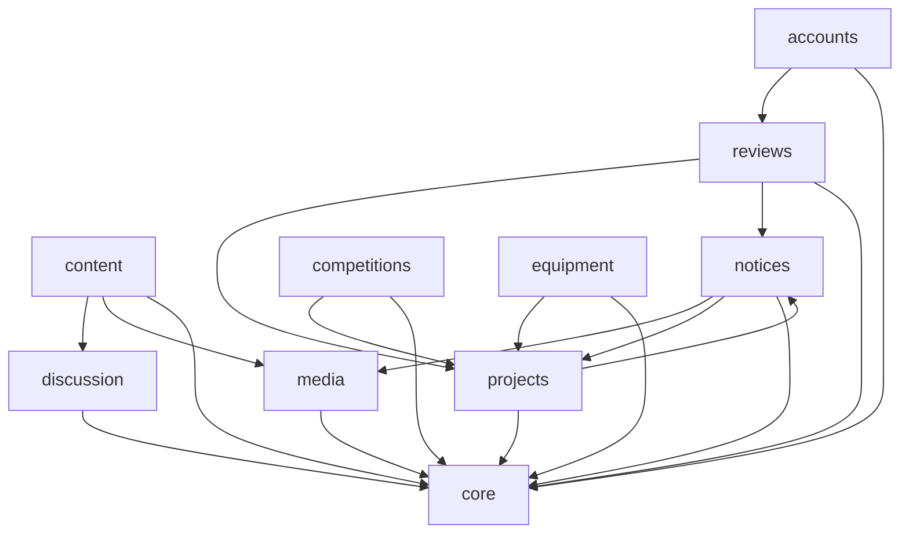

# 模块与关系

> **这份文件写的是结构**：有哪些模块、谁依赖谁、跨模块的约定是什么。
> **模块内部的事不在这里**——职责与边界、失败模式、不变量、数据流、测试要点与已知限制，
> 都在代码旁边的 [`<app>/README.md`](#6-各模块的详细说明在哪) 里。写不下去就说明写得太低了。

**什么时候看**：改代码前定位模块；加一个模块或一条入口；不确定某件事该问谁。

---

## 1. 模块清单

| 模块 | 目录 | 职责（一句话） | **明确不做什么** |
|---|---|---|---|
| config | `config/` | 项目配置包：settings、根路由、中间件（请求日志／强制改密）、日志 | 不放业务逻辑 |
| accounts | `accounts/` | 用户、成员资料、密码、资格的管理面、头像与个人图册 | 不产出「谁能做什么」的判定（本 app **没有** `permissions.py`）；不建教师账号 |
| notices | `notices/` | 公告与「我的消息」：可见性判定、广播型与事件型两类消息 | 不渲染消息目标的页面；不判断评审规则 |
| projects | `projects/` | 项目组、联系人、指导老师、入组与建组申请、项目书本体的保存 | 不做评审；不建「联系人」用户组 |
| reviews | `reviews/` | 项目书同行评审：轮次、两道关的任务、抽签、结论汇总与归档、改派、超级评审、接单开关 | 不存项目书本体；不写用户可见通知；不做资格授予 |
| competitions | `competitions/` | 竞赛信息与项目组报名登记 | 不做报名审批；送审类型不与竞赛建外键 |
| equipment | `equipment/` | 设备台账与借用登记 | 不做审批／预约／续借／逾期，不做部分归还 |
| content | `content/` | 公开展示页：社团简介、历年获奖、成员风采、首页轮播 | 不做富文本编辑；判重没有数据库约束；不登记操作入口 |
| discussion | `discussion/` | 社团空间：板块、帖子、评论、成员目录 | 板块管理只认 Django `is_superuser`；不做事后审核 |
| media | `media/` | 媒体库：图片／视频统一上传与校验 | 不做转码；不决定引用它的内容的可见性 |
| core | `core/` | 平台底座：跨应用权限口径、操作入口注册表、身份目录、审计、上传校验、取件响应、指纹 | 不在加载期依赖业务 app；注册表与目录只管**登记** |

**边界比职责更重要**——写不清「不做什么」，模块就会不断膨胀。

---

## 2. 模块间关系

实线是**模块级**（加载期）的依赖。三条要注意的：

- **`core` 是横向的**：任何 app 都可以依赖它；它**不在加载期**依赖业务 app（`core/stats.py` 在函数体内 import 业务模型与判定，那是刻意的运行期依赖）。`media` 同理只被依赖。
- **`notices ↔ projects` 是互相依赖的**，别以为方向是单向的：`notices/visibility.py` 要问 `projects.permissions.is_project_contact`（「仅联系人可见」的通知），而 `projects/services.py` 要调 `notices.services`（入组与建组的消息）。两处都在**不同子模块**里，所以不成环——但**动这两条中的任一条之前，先确认没有把环闭合**。
- **`accounts → reviews` 是全平台唯一一条反向的加载期依赖**（`accounts/admin.py` 模块级 `from reviews import lifecycle`，两张资格名册要取 `STAGE_*` 常量）。业务上 `reviews` 依赖 `accounts` 的资格字段，代码上却反过来 import——再添一条之前先确认不成环。

**刻意放在函数体内的局部 import**（打断加载期依赖用，每一处都写着理由）：

| 谁问谁 | 在哪 | 为什么 |
|---|---|---|
| `accounts` → `projects` / `reviews` | `selectors.py`、`roles.py`、`views.py` | 「当前身份」清单、成员中心、首页概览要问别的 app 的判定与取数 |
| `projects` → `reviews` | `permissions.py`、`views.py` | 项目组可见性的**评审侧那一支**、详情页的评审区块与送审表单 |
| `notices` → `discussion` / `projects` / `reviews` 的模型 | `selectors.py` | 消息行现取现算：标题、链接、说明都来自目标对象 |
| `discussion` → `notices` | `services.py` | @ 提及的消息写入与撤回 |
| `equipment` → `projects` | `apps.py` | 入口卡片的可见性条件 |

> **自测**：一次纯重构（行为不变）不该逼你改这张图。改了，说明画得太细。

---

## 3. 跨模块约定

➥ 代码里读不出「这是故意的」那类约定。

| 约定 | 内容 |
|---|---|
| **判定只写一处** | 「谁能做什么」写在各自的 `permissions.py`（或 `notices/visibility.py` 这类单点模块）。视图门槛一律 `core.permissions.require`；「谁算管理员」只问 `core.permissions.is_admin`，不写 `user.is_staff` |
| **用户组不是身份** | Django `auth.Group` 只是**内部通知的投递范围**（`Notice.visible_groups`），既不是项目组也不是身份名册，不进 `core.roles` 目录 |
| **身份分两种作用域** | `GLOBAL`（管理员授予、后台可批量改）与 `OBJECT`（业务动作产生、名册只读、不给分配入口）。后台「身份管理」分组与六张名册的依据 |
| **对象级权限收敛在 `projects.permissions`** | 联系人与成员这两个对象身份、以及 `can_view_group`（项目组侧与评审侧主张的**并集**，改它不许提前 `return`）。借用记录的可见范围**不是**判定函数，是在查询里收窄的 |
| **跨应用只走公开面** | 只经对方的 `permissions` / `services` / `selectors` 公开函数，不直接查对方的模型（模型外键除外）；要打断加载期依赖时用函数体内局部 import 并写明理由 |
| **拒绝的形态有三种口径** | 按对象判可见性的**取件**越权 → **403**；**通知详情**越权 → **404**（连存在与否都不说）；匿名 → **302** 去登录页。别改串 |
| **业务拒绝不是 4xx** | 服务层抛领域异常（`ReviewError` / `JoinRequestError` / `GroupManagementError` 等），视图翻成 flash 后 **302** |
| **受保护件落在另一个根** | `PRIVATE_MEDIA_ROOT` **刻意不在** `MEDIA_ROOT` 之下，受保护件因此没有任何 HTTP 路径能直接命中。这条边界是「取件必须走视图」的真正保障——不是 `url()` 抛异常（它返回空串） |
| **指纹的三条承诺** | `FileDigestMixin` 给七个文件字段算 SHA-256；**项目书／批注版／归档版**的取件响应另带 `Content-Digest` 与 `X-Checksum-SHA256`（图片类刻意不发）；归档件与其来源任务的指纹相同 |
| **审计 action 字符串不再改** | 一旦发布就保持连续；新增写操作照着相邻那个取名。「只追加」由数据库触发器守（迁移 `core.0003`），不是靠约定 |
| **来源 IP 只有一个口径** | `core.get_client_ip`：审计记的 IP 与 django-axes 锁定的 IP 取自同一个函数。改它等于同时改「审计记了谁」与「谁被锁」 |
| **消息的写入与撤回归 notices** | 别的模块**只调用**（`notify_*` / `clear_*`），不自己写消息表；呈现与去向也在 notices |
| **加一个 `Message.kind` 要改三处** | `KIND_CHOICES`、`selectors._CONTENT_BUILDERS`、`selectors._TYPE_LABELS`。漏第二处该行被静默跳过，漏第三处装配时整页 500 |
| **每个自家包都要在 `LOGGING["loggers"]` 里显式列一节** | 新增包忘了配（或只配一半），日志会静默不落盘。`config/tests.py` 的 `AppLoggerTests` 从四个方向盯着 |
| **登记归 `AppConfig.ready()`** | 操作入口（`core/registry.py`）与身份（`core/roles.py`）在各 app 的 `ready()` 里登记；后台「身份管理」分组的顺序必须与 `core.roles` 的 `sort_order` 一致 |
| **约束名是承诺** | 几组唯一约束与 `CHECK` 的名字被迁移与测试引用（清单见各 app 的 README）；改名要连迁移一起动，改行为更要先想清存量数据 |
| **数据格式以代码为准** | 改了数据格式必须升版本 + 在代码里**显式拒绝**旧数据，不得静默容错 |
| **时间端点逐个看清** | 竞赛报名截止是**闭端**（`now() <= deadline`）；平台上别处还有别的时间端点，门槛宽严各不相同。**别记「一律」**，口径见 [`../术语表.md`](../术语表.md) |
| **文件大小一律写 MB** | 文档与界面一律 MB，代码按 `1024 × 1024` 字节算；**不要再引入 MiB 的写法**，否则同一个上限会出现两个数字 |
| **分层约定、i18n、样式约定** | 见 [`../../CLAUDE.md`](../../CLAUDE.md) §4「全局约定」——那几条是每轮都要用的规则，只有那一个主；单位与口径见 [`../术语表.md`](../术语表.md) |

---

## 4. 各模块的详细说明在哪

**模块说明就地放在代码旁边**（`<app>/README.md`），六节：职责与边界（含**明确不做什么**）／
关键接口与失败模式／状态与不变量／数据流与时序／错误处理与诊断／测试要点与**已知限制**。
它跟代码在同一个提交里更新，改哪块就先看哪块那一篇。

| 模块 | 说明 | 模块 | 说明 |
|---|---|---|---|
| config | [`config/README.md`](../../config/README.md) | equipment | [`equipment/README.md`](../../equipment/README.md) |
| accounts | [`accounts/README.md`](../../accounts/README.md) | content | [`content/README.md`](../../content/README.md) |
| notices | [`notices/README.md`](../../notices/README.md) | discussion | [`discussion/README.md`](../../discussion/README.md) |
| projects | [`projects/README.md`](../../projects/README.md) | media | [`media/README.md`](../../media/README.md) |
| reviews | [`reviews/README.md`](../../reviews/README.md) | core | [`core/README.md`](../../core/README.md) |
| competitions | [`competitions/README.md`](../../competitions/README.md) | | |

> **为什么不成一份**：这 11 篇里有大量**读代码读不出来**的东西——失败模式、并发与锁、
> 约束为什么落在数据库、已知限制。把它们收成一份文件只有两条路：丢信息，或者把这份文件
> 撑成新的巨石。就地的好处是**改哪个模块只动哪一篇**，而且它与代码在同一个提交里。

---

## 5. 可选扩展

➥ 已落地的能力（账号与强制改密、通知可见性、站内消息、公开展示与媒体库、项目组、
竞赛报名、设备借用、项目书同行评审含初审关卡、操作入口注册表、审计日志、生产部署工件）
不再列在这里。

- **视频转码与容量**：当前直传 MP4 不转码；视频量大时引入 ffmpeg 转码／多码率，或切对象存储。
- **媒体大小上限**：图片 ≤10 MB、视频 ≤500 MB 是默认值，可按服务器带宽／磁盘调整。
- **站内消息的其余来源**：报名成功、设备到期这类提醒还没有产生机制（到期提醒要定时任务）；
  接新来源的路径见 [`notices/README.md`](../../notices/README.md)。
- **开放 API**：当前对外只有页面路由。小程序／校园系统对接需要只读接口时，先引入框架
  （DRF 曾空装着，已按「不留不用的依赖」移除），再按 [`接口.md`](接口.md) 登记。
- **可信代理与真实来源 IP**：审计日志经 Nginx 后来源 IP 记为 `127.0.0.1`，
  需要时可增加可信代理链配置（见 [`开发与部署.md`](开发与部署.md)）。
